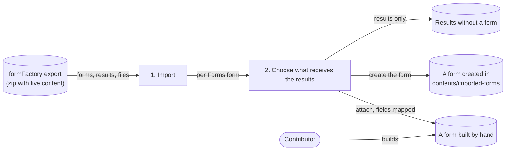
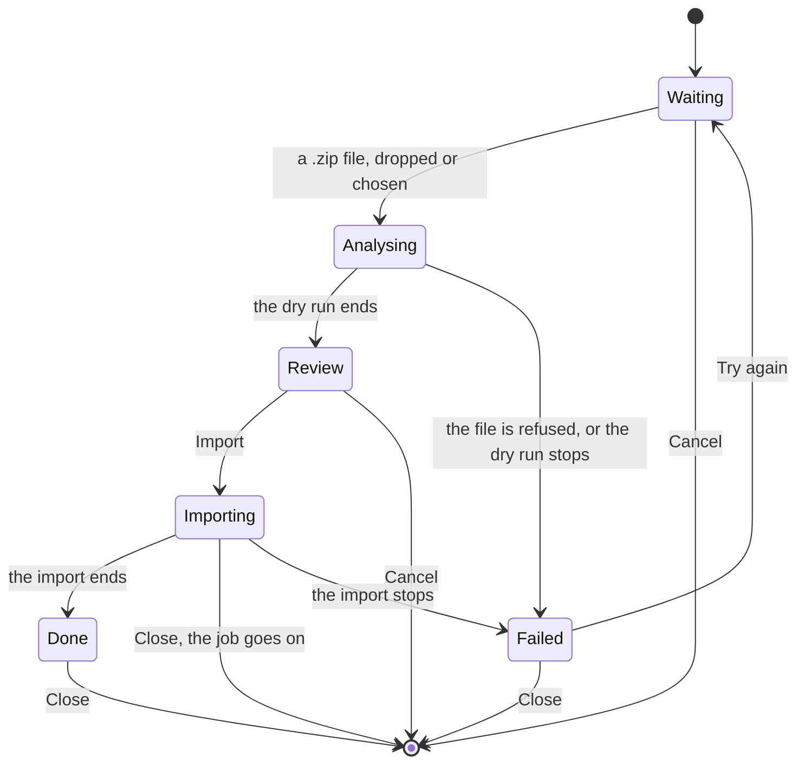
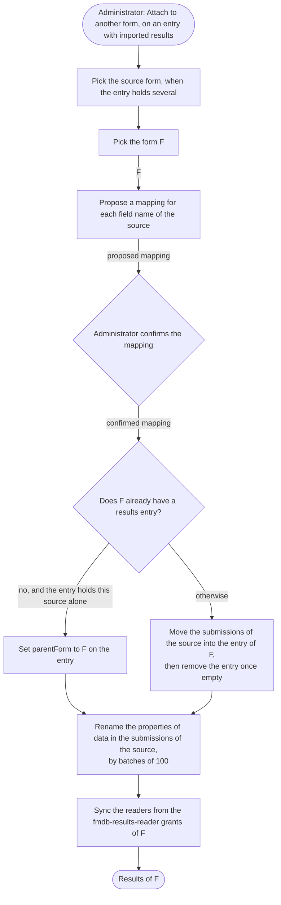

# Importing forms and results from Jahia Forms

Specification of the import of [Jahia Forms](https://github.com/Jahia/forms-core) (`forms-core` 3.x) forms
and submissions into Formidable. Status: iteration 1 implemented (the reader and the converters first, then the writer, the
job and the Results page dialog), in a module of its own, `formidable-forms-import`, since 0.6; iteration 2 implemented for the choice at import time (the results alone, a form created, an
attachment to an existing form with its mapping). The **Attach to another form** action on an entry was withdrawn before its
release: it showed on the entries that hold imported results alone, and may come back for every entry of the Results page. The
open points are listed at the end.

## Goal and iterations

A site that collected submissions with Jahia Forms moves to Formidable without losing them. The import
reads the export of the site's `formFactory` node, recreates each Forms form as a Formidable form in a
content folder of the site, and writes the submissions of that form as the results of the new form. The
work ships in two iterations.



| Iteration | What it delivers |
|---|---|
| 1. Import | Every Forms form becomes an unpublished Formidable form in the `imported-forms` content folder of the site, with system names generated from the labels, the field types Formidable has, the labels, placeholders, help texts, required rules, choices and actions that map. Every submission the Forms *save to JCR* action stored becomes a submission of that form, files included. The Results page lists, filters and exports them as native results, with the labels of the form once it is published. |
| 2. Choose what receives the results | Per Forms form, or for all of them at once, the administrator chooses in the review what receives its results: nothing until chosen, the results alone, a form created as in iteration 1, or an existing Formidable form, built by hand or reworked, whose fields the values are mapped and renamed to, the results taking the readers of that form. An **Attach to another form** action on an entry of the Results page was designed too and withdrawn before its release ([Iteration 2](#iteration-2-choosing-what-receives-the-results)). |

Iteration 1 creates a form before it writes the first submission, so the Results page, the exports and the
statuses need no change for imported results. The import never publishes, though: until a contributor
publishes an imported form, its entry shows as **Unpublished**, and the page resolves the form through its
live reference, else through the edit workspace (`FormResultsApp.tsx`), so that the columns carry the
labels of the form even then. The system names of the fields head the columns only when no form exists,
the results-only choice of iteration 2. This is why the import gives each field a readable system name, generated from
its label (`your-first-name`, not `text-input_0_1`), and why the final report of a created form invites to
publish it.

## Scope

| In scope | Out of scope |
|---|---|
| Forms 3.x: the forms and the field types of `forms-core` 3.x, and the field types of `forms-extended-inputs` that submit a value (image checkboxes, accept terms) | Forms 2.x and older |
| Every submission that the Forms *save to JCR* action saved, files included | The drafts that a visitor saved with *save the form for later* (`fcnt:storedForm`), which are not submissions |
| An import started from the Results page of the target site: a dry run and its report, then the import, which can run again | The pages that place a Forms form (`fcnt:formReference`): the contributor places the new form |
| The forms, as far as Formidable has an equivalent: what has none is reported, never silently dropped | Any deletion in Forms: the import never modifies the source |
| A prefill from the visitor profile (the jExperience bridge of Forms), carried over as the mapping of the field to that profile property when the jExperience integration of Formidable is installed | Conditional logic, the other prefills and the layout of the Forms form: reported, rebuilt by hand |

## Decisions

| Decision | Why |
|---|---|
| **The import reads the zip export of the site's `formFactory` node, taken with its live content** | The source can live on another instance, or on an instance that is being retired, so `forms-core` need not be installed where Formidable runs. That zip is the only export that carries the three things the import needs: the `jcr:uuid` of every node, which keys the forms, their fields and their results; the results themselves, which Forms writes in live only; and the uploaded files. The other exports hold the results, but no `jcr:uuid` (spike 3). See [The export file](#the-export-file). |
| **The import is a module of its own, `formidable-forms-import`, installed next to the engine** | Decided 2026-10-15, after a first iteration inside the engine behind a setting: a site that never ran Forms installs nothing, and the engine keeps no code that knows Forms. The engine offers what the import needs through its API — the results store, the toolbar of the Results page, the **No form** status — and the module owns the import jobs and the four markers of an imported node ([CND module ownership](cnd-module-ownership.md), [The module](#the-module)). Enabling the module on a site is the one switch of the import there; disabling it, or uninstalling the module, takes away the **Import** button, its endpoint and its job, nothing else: Jahia keeps the node types a module declared once it is undeployed, so the imported forms, fields and results stay readable with their markers, and the Results page keeps listing the entries as it lists any native one. Installing it again binds its types back to it. |
| **The administrator chooses, per Forms form, what receives its results: nothing, the results alone, a new Formidable form, or an existing one — nothing by default** | The results are what the import is for; a form is created only on request (decided 2026-10-09, on the first manual tests). The Results page already lives with an entry whose form is gone, and an imported entry without a form is that state named for what it is: **No form** instead of **Form deleted**, the system names of the fields as columns, its administrators as its only readers until it is attached to a form. Iteration 1 creates a form for every Forms form; [iteration 2](#iteration-2-choosing-what-receives-the-results) brings the choice. Nothing is imported until the administrator chooses (amended 2026-10-20: the results alone were the default, and a form landed by inattention): a form not chosen for is left out, by the dialog and by the endpoint alike, and a **For all forms** menu chooses for every row at once. What was true of a created form stays true: imported results under a form are native results, with labels, readers and a status. |
| **The forms land in one content folder, `contents/imported-forms`** | Formidable forms are contents of the site (`/sites/<site>/contents/...`). One folder keeps the imported forms apart from the forms built by hand, where contributors find them in jContent, review them, move them and publish them. |
| **A field gets a system name generated from its label**, `your-first-name` for "Your First name", not the Forms name `text-input_0_1` | Formidable keys the values of a submission by the node name of the field ([Save to JCR](save-to-jcr.md)), and that name heads the columns of the Results page and of the exports whenever the form does not resolve in live, so a Forms name there reads as noise. The name is generated as the Content Editor generates a system name from a title, the rule a contributor gets anyway. The import writes `data` itself, so the new names cost no rename, and each field remembers its Forms identity for the later runs. See [The system names](#the-system-names). |
| **The label of a field is its title, else its placeholder, else its name** | Forms often leaves the title of a field empty and shows the placeholder as its only text: in the sample export, eight of the nine fields have an empty title, and their placeholders read "Your First name\*", "Votre prénom\*". See [The labels](#the-labels). |
| **The submitter's IP address and user name are not imported** | Formidable does not store them for its own submissions, because they are personal data (see [Save to JCR](save-to-jcr.md)). An imported submission must not hold more than a native one. The administration guide states this, so that a site that needs them exports them from Forms first. |
| **The forms are created unpublished, the results are written in live** | A contributor reviews a form, completes what the import reported, then publishes it: the import never publishes. Until then the Results page shows the entry as **Unpublished**, with the system names of the fields as columns, as for any native form that is not published. Results only exist in live in both products: the import writes them there, as `SaveToJcrFormAction` does, and they are never published. |
| **`origin` = `jahia-forms` on an imported submission** | `origin` is the discriminator that [Save to JCR](save-to-jcr.md) documents for "a legacy-forms import". The Results page and the exports can tell an imported submission from a native one. |
| **A Forms form is recognised by its `jcr:uuid` and by the `jcr:uuid` of its results node, a field by its `jcr:uuid`, a submission by its node name** | All of them are in the zip export. A later run finds the form it created, the field each value belongs to and the submissions it wrote, and adds only what is missing. The form keeps both of its keys because either can be missing: the form's, once Forms deleted the form; the results node's, while the form was never published. See [Running it twice](#running-it-twice). |
| **A prefill from the visitor profile becomes the mapping of the field to that profile property** | The jExperience bridge of Forms (`jexperience-forms-bridge`) prefills a field from a jCustomer profile property and maps the submitted value back to it (`fcnt:mfffPrefill`), or maps without prefilling (`fcnt:mfffMappingOnly`); its `dataKey` holds the property, whose `itemId` is the identifier Formidable's jExperience integration stores in `jExperienceProfileProperty` ([jExperience integration](jexperience-integration.md)). The import writes that property, the prefill switch and what follows the write (`hideAfterPrefill` → hidden, `makeReadOnlyAfterPrefill` → read-only, else editable) when the integration is installed, its mixin reaches the field type, and the profile server of the site declares the property with a type the field holds, and reports the mapping so that the contributor checks it. The integration answers that last point through `VisitorProfileSchema`, an interface of the engine API it implements from its catalog of profile properties and the type rule of its editor (`FieldShapes`): the mapping rule of a form skips, without a word, a field mapped to a property jCustomer does not declare or whose type does not fit, so the import never writes one; it reports the property to create, or the type that does not fit, instead. When jCustomer cannot be reached, the mapping is written as Forms had it, with a line to check that the property exists. Without the integration, or on a type it does not reach, the report names the property to map by hand. The other prefill flavours of Forms (user info, geolocation) have no counterpart and are reported. |
| **The import starts from the Results page, on the sites the module is enabled on** | An **Import Jahia Forms results** button in the toolbar of the Results page, shown to the administrators of a site the module is enabled on and to no one else, opens a dialog that takes the export, shows the report of a dry run, then imports into the current site. Enabling the module on the site is the one switch: no setting doubles it. See [Running it](#running-it). |

## Source model (Forms 3.x)

This section describes what the import reads. Paths are relative to the root of the export.

### The export file

The export is taken in the **Repository explorer**: open the site, right-click its `formFactory` node,
choose **Export**, then **Export Zip with live content**. The zip holds two Jahia *document view* files,
`repository.xml` and `live-repository.xml`, and the binaries of the files under them, each at
`live-content/<path of the file node>/<file name>`, the path being relative to the parent of the exported
node (`DocumentViewExporter.buildBinaryPathInZip`), with the split folders decoded: a PDF sent through the
file field `file-upload_0_6` sits at
`live-content/formFactory/results/contact-us/submissions/10/13/09/19/32/<uuid>/file-upload_0_6/document.pdf/document.pdf`
in the second sample export. In the first sample export
the two files are identical: the forms come from the edit workspace, the results from live, and each
live-only node is marked `j:originWS="live"`. The import reads `live-repository.xml` when the zip has one,
`repository.xml` otherwise.

In these files:

- node names are ISO 9075-encoded: `_x0020_` is a space, and `_x0030_6` is the node name `06`;
- a multi-valued property is one attribute, and spaces separate its values, each value encoded the same
  way (`result="+44_x0020_7911_x0020_123456"` in the sample); a single value is written as it is
  (`jsonValue="Your First name*"`), except a reference, which `DocumentViewExporter` encodes like a
  multi-value (`JCRMultipleValueUtils.encode`): the import decodes names, multi-values and the two
  references it reads, `parentForm` and the `label` of an answer, so a form or a field named with a
  space keeps its results;
- every node carries `jcr:uuid`, `jcr:created`, `jcr:createdBy` and `jcr:lastModified`;
- a reference is nonetheless written as a path, `#/<path>` relative to the export root, as in
  `parentForm="#/forms/contact-us"`;
- i18n properties live on `j:translation_<lang>` child nodes.

The other two exports hold less, and the dry run refuses them with the reason, and the procedure above:

- **Export XML**, a `repository.xml` alone: it holds the results, but no `jcr:uuid` and no binary, so the
  files of the submissions are lost;
- **Export Zip**, without live content: it holds the results too, each live-only node marked
  `j:originWS="live"`, but no `jcr:uuid` on the forms, the fields or the results (spike 3 measured it on
  the sample site), so a later run could not find what the first one wrote: refused with the same message
  as the XML export.

A zip taken from jContent, which reads the edit workspace only, and the export of a single form from the
Forms builder hold no results at all, and are refused for that, with the same procedure.

The administration guide gives the same procedure, with the two screens.

### The forms

```text
formFactory
└── forms
    └── <formName>
        ├── j:translation_<lang>
        ├── step-<n>
        │   └── <fieldName>
        │       ├── j:translation_<lang>
        │       ├── placeholder, helptext, inputsize, rows, choices…
        │       ├── validations
        │       │   └── <rule>
        │       ├── prefills
        │       └── logics
        └── actions
            └── <action>
```

| Name | Responsibility |
|---|---|
| `<formName>` | The `fcnt:form`. It holds `jcr:title` per language, `buildingLang`, `afterSubmissionText`, `cssClass`, `numberOfSteps`, and the mixins `fcmix:displayCaptcha`, `fcmix:trackUser`, `fcmix:formSavable`, `fcmix:submissionConstraints`. |
| `step-<n>` | A `fcnt:step`, with `stepNumber`. A form has at least one. |
| `<fieldName>` | A field definition: one of the `fcnt:*Definition` types, all with the `fcmix:definition` mixin. It holds `jcr:title` per language, often empty, and `choiceField`, the names of the child option nodes that hold its choices. |
| Its option children | `fcnt:definitionOptions` nodes, named after the option: `placeholder`, `helptext`, `inputsize`, `rows`, `choices`… A `fcnt:definitionOptionsTranslatable` holds its `jsonValue` per language. The `choices` of a choice field are a JSON `[{"key","value"}]` per language. |
| `validations/<rule>` | A rule: `fcnt:requiredValidation`, `emailValidation`, `rangeValidation`, `rangeLengthValidation`, `regexValidation`, `fileValidation`, `fileNumberValidation`, `equalToValidation`… each with a `message` per language. |
| `prefills`, `logics` | The prefills and the conditional logic. A prefill from the visitor profile (`fcnt:mfffPrefill`, `fcnt:mfffMappingOnly`, from the jExperience bridge of Forms) becomes the mapping of the field to that profile property when the jExperience integration is installed; the import reports the other prefills and the logic, and rebuilds neither. |
| `actions/<action>` | One of `fcnt:saveToJcrAction`, `sendEmailAction`, `sendEmailToSubmitterAction`, `redirectToAPageAction`, `redirectToUrlAction`, with its options as children. |

### The results

```text
formFactory
└── results
    └── <formName>
        ├── labels
        │   └── <fieldName>
        ├── actions
        └── submissions
            ├── fakeSplittedResultForAreaDisplay
            └── <MM>
                └── <dd>
                    └── <HH>
                        └── <mm>
                            └── <ss>
                                └── <uuid>
                                    └── <fieldName>
                                        └── <file>
```

| Name | Responsibility |
|---|---|
| `<formName>` | The `fcnt:formResults` node. It holds `parentForm`, a weak reference to the `fcnt:form` that the export writes as a path, then `buildingLang` and `j:translation_<lang>/jcr:title`. |
| `labels/<fieldName>` | A label node, a `fcnt:definitionOptionsTranslatable` under the `fcnt:resultLabels` node `labels`. It holds `fieldId`, the UUID of the field, and `label` and `choices` per language. Forms refreshes it on each publication of the form, so it follows the current name of the field. |
| `actions` | A copy of the actions of the form. The import ignores it. |
| `submissions` | A `fcnt:submissions` node with `jmix:autoSplitFolders`, with no year level. The current `forms-core` 3.x splits by month, day, hour, minute and second (`FormSubmission`); older 3.x releases stopped at the hour, as the sample export does. The import walks the `fcnt:splittedResult` folders at any depth and takes every `fcnt:result` it finds. |
| `fakeSplittedResultForAreaDisplay` | A placeholder. The import skips it. |
| `<uuid>` | A `fcnt:result`. It holds `jcr:created`, the date of the submission, and `origin`, the referer or the request URI. When the form tracks users, it also holds `ip_address` and `jcr:createdBy`. |
| `<fieldName>` | A `fcnt:resultField`. It holds `result`, a string that is always multiple, then `label`, a weak reference to `labels/<fieldName>`, and `optional`. |
| `<file>` | A `jnt:file`, for a file field. Its binary is in the zip. |

Forms writes a value as follows (`SaveToJcrAction` in `forms-core`):

- every value is a string, so one answer is a one-value `result`, and several answers (checkboxes, a
  multiple select) are several values;
- a choice field stores the option key, and the label of the option is in the `choices` of the field
  and of its label node;
- a date is the moment.js `toISOString()` of the chosen date, a UTC instant: a date picked as 13 August in
  Paris is `2024-08-12T22:00:00.000Z`;
- the matrix, rating and country fields of `forms-core` store one JSON object as a string, with a `rendererName`
  (`matrixRadios`, `matrixCheckboxes`, `rating`, `country`), shaped as their directives submit it
  (`forms-core/src/main/resources/fcnt_*Definition/js`): a matrix keeps one key per row beside the renderer
  name, `{"Price":"Good","Service":"Poor","rendererName":"matrixRadios"}`; a rating keeps its number under
  `value`, `{"rendererName":"rating","css":"fa-star rated","type":"…","value":4}`; a country keeps its code
  under `country.key`, `{"country":{"key":"FR","name":"France"},"rendererName":"country"}`;
- an accept-terms box (`forms-extended-inputs`) stores its `yes` label when ticked, "Accepted" by default,
  and its `no` label when not, "Not Accepted", in the language of the form (`ng-false-value="'{{input.no}}'"`);
- a file field stores a JSON object `{"url":[],"name":[],"type":[],"size":[],"image":[],"rendererName":"fileUpload"}`,
  and the files themselves are `jnt:file` children of the `fcnt:resultField`;
- a password field stores the placeholder `**********`, never the password;
- empty answers are not stored.

**A renamed field.** The `fcnt:resultField` keeps the name the field had when the visitor submitted, and
its `label` points at the label node of that field, which follows the current name and holds its
`fieldId`. The import names a value after the field it created for that `fieldId`, so all the submissions
of one field land under one name, the system name of the field in the recreated form.

## Iteration 1: import

### Target model

```text
/sites/<site>
├── contents
│   └── imported-forms
│       └── <formName>
│           ├── fields
│           │   └── <fieldName>
│           └── actions
│               └── <action>
└── formidable-results
    ├── <entry>
    │   └── submissions
    │       └── <yyyy>
    │           └── <MM>
    │               └── <dd>
    │                   └── <submission>
    │                       ├── data
    │                       └── files
    │                           └── <fieldName>
    │                               └── <file>
    └── import-jobs
        └── <job>
```

| Name | Responsibility |
|---|---|
| `imported-forms` | A `jnt:contentFolder` titled *Imported from Jahia Forms*, created by the first import when the site has none. |
| `<formName>` | A `fmdb:form` with `fmdbmix:importedForm`, named after the Forms form, or the next free name in the folder. [The forms](#the-forms-1) gives its content. |
| `fields/<fieldName>` | One field per Forms field, named as [The system names](#the-system-names) says, with `fmdbmix:importedField`. A form with several steps holds one `fmdb:step` per `fcnt:step` under `fields`, and the fields of that step under it. |
| `<entry>` | The `fmdb:formResults` of the new form, as the engine creates it (`FormResultsStore`): named after the form, or the next free name, `parentForm` set to the form, `buildingLang` from Forms, the ACL inheritance broken. It carries `fmdbmix:importedResults`. From iteration 2, the entry of a Forms form imported with the results-only choice has no `parentForm` (see [Results only](#results-only)). |
| `<submission>` | A `fmdb:formSubmission` with `fmdbmix:importedSubmission`. It is named `submission-<yyyyMMdd-HHmmss>-<xxx>` from the original date, in UTC, as the engine names it. |
| `data` | The `fmdb:submissionData` node: one string property per field name, multiple for several answers. |
| `files/<fieldName>/<file>` | A `jnt:folder`, a `jnt:folder` and a `jnt:file`, as the engine writes them. |
| `import-jobs/<job>` | The jobs of [Running it](#running-it). |

### The forms

Each `fcnt:form` of the export becomes one `fmdb:form`:

| Forms | Formidable |
|---|---|
| `jcr:title` per language | `jcr:title` per language, or the node name when every title is empty |
| `afterSubmissionText` | `submissionMessage` |
| One `fcnt:step` | The fields directly under `fields` |
| Several `fcnt:step` | One `fmdb:step` per step, titled after it, in the order of `stepNumber` |
| A `fieldsetStart` and its `fieldsetEnd` | One `fmdb:fieldset`, titled after the start, holding the fields between them |
| The `button` definitions | Not fields: the title of a button fills `submitBtnLabel`; the three labels of a `buttonTriple` are part of spike 4 |
| `fcmix:displayCaptcha` | The form's captcha, when the instance has a captcha configured; reported otherwise |
| `fcmix:trackUser` | Nothing: Formidable does not track the submitter |
| `fcmix:formSavable`, `fcmix:submissionConstraints` | Nothing, reported: Formidable has neither *save for later* nor submission constraints |
| `cssClass`, the layout | Dropped |

A form whose results the export holds but which `forms` no longer holds, because it was deleted in Forms,
is built from its label nodes alone: one `fmdb:inputText` per label node, or one `fmdb:select` with the
choices of the label node when it has some, titled and named from the `label` of the label node by the
same rules as the other fields. Its title is the title of the `fcnt:formResults`, and the `jcr:uuid` of
that node is its only key (see [Running it twice](#running-it-twice)).

### The fields

Each field definition becomes one field of the type below, named as [The system names](#the-system-names)
says. The third column gives what the import writes into `data` for that field, from the Forms value.

| Forms definition | Formidable field | Value |
|---|---|---|
| `inputDefinition` | `fmdb:inputText` | Unchanged |
| `phoneDefinition` | `fmdb:inputText`, reported: Formidable has no phone field | Unchanged |
| `emailDefinition` | `fmdb:inputEmail` | Unchanged |
| `textAreaDefinition` | `fmdb:textarea`, with `rows` | Unchanged |
| `numberDefinition` | `fmdb:inputNumber` | Unchanged |
| `hiddenDefinition` | `fmdb:inputHidden`, with its `value` | Unchanged |
| `passwordDefinition` | Not recreated, reported: Forms masked the password in storage and in the mail, but a Formidable text field would store and mail it in clear | Dropped, with the placeholder `**********` |
| `selectBasicDefinition`, `selectMultipleDefinition` | `fmdb:select`, `multiple` for the second, with manual options | The option key, one or several, unchanged |
| `multipleRadiosDefinition`, `multipleRadiosInlineDefinition` | `fmdb:radio` with manual options | The option key |
| `multipleCheckBoxesDefinition`, `multipleCheckBoxesInlineDefinition` | `fmdb:checkbox` with manual options | The option keys |
| `switchDefinition` | `fmdbext:switch`, its `onLabel` and `offLabel` from the `textOn` and `textOff` of the switch; without the extended inputs, `fmdb:radio` with the two options `true` and `false`, labelled with those texts | `true` or `false`, unchanged |
| `datePickerDefinition`, `simpleDateDefinition` | `fmdb:inputDate` | `yyyy-MM-dd`: the instant plus 12 hours, truncated to the UTC day (below) |
| `countryListDefinition` | `fmdb:select` on the `country` options source when the instance declares one (see [Choice field options sources](choice-field-options-sources.md)), else with the choices of the label node | The country code, the `key` of the `country` object in the JSON |
| `ratingDefinition` | `fmdbext:rating`, its `maxValue` from the `max` of the Forms rating; without the extended inputs, `fmdb:inputNumber` | The `value` of the rating JSON |
| `matrixRadiosDefinition`, `matrixCheckBoxesDefinition` | `fmdb:textarea`, reported: Formidable has no matrix | One line per row of the JSON, `row: answer(s)`, in the order of the text |
| `fileUploadDefinition` | `fmdb:inputFile`; `accept` from the type groups a `fileValidation` selects (`image`, `audio`, `video`, `pdf`, `text` have an `accept` equivalent, `all` restricts nothing, `doc` is a regular expression over the office types, reported); `multiple` when the `filenumber` of a `fileNumberValidation` is not 1 | The files are copied under `files/<fieldName>/`, and the JSON is dropped |
| `acceptTermCheckboxDefinition` (`forms-extended-inputs`) | `fmdbext:consent`, its `statement` from the `termsLabel` of the box as its visitors read it: the braces, which marked the text of the link to the terms file, go, the text stays, and the file (`link`, a repository path) is reported; the title of the field when the box has no terms label. Without the extended inputs, `fmdb:checkbox` with one option, the accepted value | `true` when the answer is the `yes` label of the box, nothing when it is the `no` label, for the consent and for the checkbox alike; any other text is kept, with a note |
| `imageCheckboxDefinition` (`forms-extended-inputs`) | `fmdb:checkbox` with manual options, the images dropped | The option keys |
| `contentDisplayDefinition` (`forms-extended-inputs`) | Not recreated, reported: it displays a content, submits nothing | — |
| Any other type | `fmdb:inputText`, reported | Unchanged |

The `fmdbext:*` types belong to `formidable-extended-inputs`. The import uses them when the repository
registers the type, as the migrations test a type before they query it, and falls back on the
`formidable-elements` type of the row otherwise, with a line in the report.

For every field:

- `jcr:title` per language follows [the label rule](#the-labels);
- `placeholder` and `helptext` become `placeholder` and `helpText`; a select, which has no placeholder,
  takes it as its `optionsEmptyLabel`; a setting the target type does not declare is reported, never
  written, so that the writer meets no constraint violation;
- a `requiredValidation` sets `required`, and its message becomes `msgValueMissing`;
- a `rangeLengthValidation` sets `minLength` and `maxLength`, a `rangeValidation` sets `minValue` and
  `maxValue`, a `regexValidation` sets `pattern`, each with its message in the slot of the type
  (`msgTooShort` and `msgTooLong`, `msgRangeUnderflow` and `msgRangeOverflow`, `msgPatternMismatch`); an
  `emailValidation` on an e-mail field fills `msgTypeMismatch`. A rule the field type cannot carry,
  and `equalToValidation`, are reported;
- a manual option is written as Formidable stores it, `{"value","label","selected"}` per language: the Forms
  key becomes the value, so that the imported values match, and the Forms label becomes the label;
- a prefill from the visitor profile (`fcnt:mfffPrefill`, `fcnt:mfffMappingOnly`) is written as the mapping
  of the field to that profile property when the jExperience integration is installed and reaches the field
  type and the profile server declares the property with a type the field holds (see the decisions), the first
  of the kind on a field; every other prefill, and `logics`, are reported,
  with the names of the fields they touch, and nothing is written for them. `inputsize` is dropped.

**The date rule** needs no time zone. Forms stored the local midnight of the visitor: for a visitor at the
offset `o`, the instant is the chosen day minus `o`. Adding 12 hours and truncating gives back the chosen
day for every offset above −12 and up to +12 hours. The Paris example above, at +2, becomes 13 August
again. A single time zone for every submission would instead give the previous day to every visitor east
of that zone. The rule fails at +13 and +14, the offsets of New Zealand in summer, Tonga, Samoa and
Kiribati: their visitors get the previous day. The offsets in use span 26 hours, more than a day, so no
rule without a time zone covers them all. The administration guide states this limit.

### The labels

The title of a recreated field, per language of the Forms form, is the first text found among:

1. the `jcr:title` of the field definition;
2. the `label` of its label node under `results/<formName>/labels`, which Forms filled from the same
   title at the last publication, and which may hold a text the definition has lost;
3. its `placeholder`, without a trailing `*` and the spaces before it: Forms contributors mark a required
   field this way in the placeholder, and Formidable renders its own mark on a required field;
4. the node name of the field.

In the sample export, `text-area_0_4` gets "Your Enquiry" / "Votre demande" from its title, and the eight
other fields get "Your First name", "Votre prénom", "Your Email Address", "Votre courriel"… from their
placeholders. The placeholder itself is kept as the field's placeholder, with its `*`.

The label of an option is the Forms label of the choice, per language, and its value the Forms key.

### The system names

The node name of a recreated field is generated from its label in the `buildingLang` of the form, as the
Content Editor generates a system name from a title (`JCRContentUtils.generateNodeName`): lower case,
accents removed, spaces and punctuation turned into hyphens, cut at 128 characters, the default of
`jahia.jcr.maxNameSize`. In the sample export,
`contact-us` gets `your-first-name`, `your-last-name`, `your-email-address`, `your-telephone-number` and
`your-enquiry`, and `newsletterregistration` gets `firstname`, `lastname` and `enter-your-email-here`:
the rule gives what the contributor would have typed, no more, and the contributor renames what reads
badly.

The name is unique in the form: a second field with the same label takes the next free name, `email-1`.
A field without any label keeps its Forms name, `text-input_0_1`. A generated name that is a request
parameter the submission pipeline reads for itself (`fid`, `lang`) takes a suffix too.

Each field carries `fmdbmix:importedField`, with the `jcr:uuid` of the Forms field as `sourceId` and its
Forms node name as `sourceName`: the mapping from the Forms names to the new ones lives on the form, and a
later run reads it there. The values of a submission are written under the new names directly, so no
rename ever runs. The Results page and the exports show these names as column heads while the form is not
published, which is the reason to generate them: `text-input_0_1` would stand there instead.

### The actions

| Forms action | Formidable action |
|---|---|
| `saveToJcrAction` | `fmdb:save2jcrAction`, so that the form keeps saving once published. A form that Forms did not save gets no action: the imported results need the entry, which the import creates itself, not the action, and a form that starts keeping the personal data of its visitors must be a choice of the site, not of the import. The report says: "Forms did not save this form's submissions; add *Save to JCR* to keep saving them." |
| `sendEmailAction` | `fmdb:emailNotificationAction`, with the `to` recipients, the sender and the subject of the Forms action. The CC and BCC addresses are reported, not carried: Formidable sends one message to one list, where they would be shown to the other recipients. The body is reported, because the two templates differ |
| `sendEmailToSubmitterAction` | `fmdb:emailNotificationAction` with no recipient, reported: Formidable has no action that writes to the submitter |
| `redirectToAPageAction`, `redirectToUrlAction` | Reported, with the target, until the [redirect action](redirect-action.md) ships |
| Any other type | Reported |

### The submissions

| Forms (`fcnt:result`) | Formidable (`fmdb:formSubmission`) |
|---|---|
| `jcr:created` | `jcr:created` holds the date of the submission. The property is protected, and `JCRNodeWrapper.addNode(name, type, uuid, created, createdBy, lastModified, lastModifiedBy)`, what the Jahia import calls, sets it. The auto-split listener places only the direct children of `submissions`, so the import creates the `yyyy/MM/dd` folders itself and adds the submission under them, where the listener leaves it (verified on 8.2, spike 1). |
| `origin`, the referer or the request URI | `referer` |
| — | `origin` = `jahia-forms` |
| — | `locale` holds the `buildingLang` of the form, because Forms does not record the language of the visitor. |
| — | `timeZone` is not set, because Forms does not record it. |
| `ip_address`, `jcr:createdBy` | Not imported |
| The node name, a UUID | `sourceId` of `fmdbmix:importedSubmission` |
| Each `fcnt:resultField` | One property of `data`, named after the field created for the `fieldId` of its label node, converted as [the fields](#the-fields) say. A value whose field the form no longer holds, because a contributor deleted it between two runs, keeps its Forms name. |
| The `jnt:file` children of a field | `files/<fieldName>/<file>`, under the same name, with the binary read from the zip |

### Content model

The engine declares the import's types beside the results types, in `definitions.cnd`. None of them names
Forms: `sourceSystem` does.

```cnd
// On a form the import created. sourceId is the jcr:uuid of the Forms form, sourceResultsId the
// jcr:uuid of its fcnt:formResults; a later run looks a form up by either, hence both indexed. At least
// one is set.
[fmdbmix:importedForm] mixin
 - sourceSystem (string) mandatory hidden indexed=no
 - sourceId (string) hidden
 - sourceResultsId (string) hidden
 - sourcePath (string) hidden indexed=no

// On a field the import created: the Forms field it stands for, and the Forms name its values had.
[fmdbmix:importedField] mixin
 - sourceId (string) mandatory hidden indexed=no
 - sourceName (string) mandatory hidden indexed=no

// On a results entry that holds imported submissions, of one source form or several after iteration 2.
// mappings holds, per source form, the mapping that an attachment applied (one JSON string each).
[fmdbmix:importedResults] mixin
 - sourceSystem (string) mandatory hidden indexed=no
 - sourceFormIds (string) multiple hidden
 - mappings (string) multiple hidden indexed=no

// On an imported submission. sourceId is what a later run looks up, hence indexed. sourceFormId is the
// key of its source form: the form's sourceId, or its sourceResultsId when Forms had deleted the form.
[fmdbmix:importedSubmission] mixin
 - sourceId (string) mandatory hidden
 - sourceFormId (string) mandatory hidden indexed=no

[fmdb:importJobs] > jnt:content, jmix:accessControlled
 + * (fmdb:importJob) = fmdb:importJob

[fmdb:importJob] > jnt:content
 - state (string) indexed=no
 - report (string) indexed=no
 - message (string) indexed=no
 - updated (date) indexed=no
 - choices (string) indexed=no
 + file (jnt:file) = jnt:file

// The results root of a site may hold the jobs node: set on the root by the first import of the site.
[fmdbmix:importJobsParent] mixin
 + * (fmdb:importJobs)
```

Every property of the four markers is `hidden`: the import and the attachment write and read them, and a
contributor who opens an imported form or field in the editor has nothing to do with them, so the Content
Editor does not show them. `ImportMarkersCndTest` holds the rule: a marker property without the flag fails the
build.

`fmdb:resultsFolder` takes one child of type `fmdb:importJobs`, for the jobs of [Running it](#running-it), through
`fmdbmix:importJobsParent`, a mixin of the module that the first import of the site sets on the root (the
repository checks a child against the mixins a node carries: an `extends` in the CND would not do):
a residual child, found by its type and named `import-jobs` unless a results entry, which is
named after its form, holds that name already. Its ACL inheritance is broken, as on a results entry, so
the jobs and their files stay with the administrators.

### The readers

The entry gets the ACL that `SaveToJcrFormAction` gives a new entry, synced from the `fmdb-results-reader`
grants of the form. A form the import just created has none, so only administrators read its results
until a contributor grants the role on the form, as for any form (see
[Results permissions](../administration/results-permissions.md)). The final report says so.

### Running it

The import starts from the toolbar of the Results page, next to **Export**, **Delete** and **Refresh**.

**The switch.** The module is enabled on the site, as any module is — the **Modules** page of the site in
the administration, or `enable` in a provisioning script — and that is the one switch of the import: the
import is used once per site, and an administrator enables the module on that site for the time of the
migration, then disables it there, or uninstalls it. The button shows after **Refresh** when the module is
enabled on the current site and the user is an administrator of it, which is the `site-admin` permission on
the site node, the one the site-administrator role grants; the endpoint reads both off the site node on
every call, and the upload and the start of an import refuse a site the module is not enabled on. The writes
themselves run in a system session. A setting that doubled the switch, `importButtonEnabled`, went with the
move into a module: one place to look, the site's modules, and nothing to turn off again once the site is
done. The module ships one configuration file, `org.jahia.modules.formidable.formsImport.cfg` (see the
[administration guide](../administration/configuration.md)):

| Setting | Default | Effect |
|---|---|---|
| `maxFileSizeMb` | `200` | The largest export the dialog accepts |

**The site.** The import writes into the site whose Results page is open. A `formFactory` export belongs
to one site, and its paths are relative to its root, so nothing in the file names a site: the administrator
opens the Results page of the target site, which may differ from the source site.

**The dialog.** The **Import Jahia Forms results** button carries Moonstone's `Upload` icon. It opens a dialog that runs a dry
run first, then the import:



| State | What the dialog shows |
|---|---|
| Waiting | A drop zone that takes a `.zip` file by drag and drop, and a **Choose a file** button that opens the file picker. Another type, or a file above `maxFileSizeMb`, is refused in the dialog with its reason. The dialog opens in this state unless the site has an import that is running, or that ended and whose report nobody has read: it then opens in that job's state. |
| Analysing | The file name and a spinner, while the server reads the export and writes nothing. |
| Review | The report of the dry run (below), one row per form of the export, and two buttons: **Import** and **Cancel**. A report with nothing to import (every form and every submission already imported) shows **Close** alone. While another import runs on the site, **Import** is refused with that reason. Iteration 2 adds to each row a menu, **What to do**, the choice of what receives its results, and above the rows a menu, **For all forms**, that chooses for every row at once (see [Iteration 2](#iteration-2-choosing-what-receives-the-results)); nothing is chosen at first, and **Import** waits until an attachment names its form, and while every form is left out. |
| Importing | The file name and a spinner. The dialog can be closed: the job goes on without it, and the dialog, opened again on this site, shows the running import, or its end state once it has ended. |
| Done | Moonstone's `Check` icon, the submissions imported, a line asking to review and publish the forms when the import created some, then the final report in the same rows, each saying what received the results and how many submissions were not written. **Download the report** and **Close**, which refreshes the list of entries. |
| Failed | The reason, as the server gives it (an export without results or without identifiers, a broken zip, a lost connection), then **Try again** and **Close**. Both remove the failed job: **Try again** goes back to Waiting. An import that stopped on its way also offers **Download the report**, with what it wrote before it stopped. |

**The server.** The file is uploaded once, by a `POST` to an endpoint of the engine on the current site.
It is stored in the repository, not on the disk of one server: a `fmdb:importJob` node under
`formidable-results/import-jobs`, in live, holds the file and the state of the job. Each phase is a job of
Jahia's **persistent** scheduler, the one backed by the database (`SchedulerService`), not the RAM one,
which would lose both the uniqueness and the recovery below: the upload starts the dry run, and **Import**
starts the import on the same node. The endpoint answers each start with the job's identifier, and the
dialog asks for its state every second until it ends, so that a long phase never runs into a proxy
timeout.

The reader is a streaming XML parser (StAX), because an export of 200 MB does not fit in memory as a
document, and it is read twice, by the dry run and by the import. It reads the two `repository.xml`
entries of the zip and the binaries that the submissions reference, nothing else, with external entities
disabled and each entry bounded in size.

On a cluster, the persistent scheduler runs on the processing server only, so the jobs run there, while
the upload, the poll and **Import** reach whichever server the load balancer picks. All of them read the
file and the state from the repository, so no server needs to be the one that took the upload.

**One import at a time per site.** The check on `sourceId` happens before a batch is written, so two
imports of overlapping exports, from two tabs or two administrators, could both find a submission absent
and both write it. The import job is therefore scheduled under one name per site,
`forms-import-<siteKey>`: the persistent scheduler holds one job of a name at a time, across the cluster,
so the second **Import** finds the job and is refused, in the review state, with its reason ("another
import is running on this site"). A processing server that stops mid-import leaves its job in the
database; the job requests recovery, so it runs again when that server is back, and the import then finds
the forms and the submissions already written by their `sourceId`. Until then the job reads as running,
in the dialog of anyone who opens it on that site. Dry runs write nothing, so each runs under its own
name, side by side. The jobs are durable, so an ended import keeps its name in the scheduler: the next
**Import** drops it first, and refuses only a job that is still added, scheduled or executing. A job node
that reads as running while the scheduler holds no active job for it, because the module was stopped or
redeployed between the schedule and the run, is marked failed, with that reason, the next time the dialog
asks the site for its job, so that it stops reopening.

The import writes the forms first, then the submissions by batches of 100, and saves each batch on its
own. A submission that cannot be written does not stop the import: the batch it was in is dropped and its
other submissions written again one by one, each saved alone; the one that fails is left behind, counted as
not written in the report, with the reason, and the next run of the same export tries it again. Past 100
of them, or on any other failure, the import stops: what it saved stays, the job ends failed and keeps the
report as far as it went, with why it stopped. When a phase ends, the job node keeps its end state and its report. A dry run keeps its file for the
import that may follow; the import drops the `file` child when it ends, because it has served. The dialog
reads the report from the node, then **Close** removes the node, so a reload, or a second administrator,
still finds the report until someone has read it. A node nobody read is removed one hour after its end, as
is a dry run that no import followed; **Cancel** removes the node too, even while the dry run runs, which
then finds nothing to do. A running import is never removed.

The dry run and the import read the export the same way, so the final report gives the figures of the dry
run, except for what another import wrote in between.

The report gives, per Forms form:

- the form it creates, with its name in `imported-forms`, or the form it found from an earlier run;
- its fields, with the system name and the type each one takes, their titles and the distinct values the
  submissions hold (up to thirty, for the mapping of an attachment), and the fields, rules, actions and
  settings that are reported because Formidable has no equivalent;
- the number of submissions found, to import and already imported;
- the values converted, dropped (passwords) or not converted (a JSON that does not parse);
- the files, and their total size.

What the report says of a form and of its fields is a list of notes. A note is a code, its parameters and a
level (`ImportNote`): **action** for what was lost or approximated and is to be redone or checked by hand (a
redirect, a rule the field type lacks, a field created as the closest type), **info** for what was carried
over and is only worth knowing (a captcha turned on, a field linked to the visitor profile). The server
writes no sentence: the dialog translates each code under `formResults.import.note`, with the field types
and every rule, prefill, action, field kind and setting in words (`formResults.import.terms`, a name the locales do
not know read as words drawn from it, without its namespace): its sentences never show a node type or a Forms type
name. The one path they show is the target of a Forms redirect, a page of the source site, which the
contributor needs to rebuild it. The notes only matter when the form is created, so the row of a form to create shows a count,
**N to review**, in a **Notes** column, a button that unfolds the notes under the row: what to review by hand, then the fields mapped to the visitor profile, as a compact grid whose status column takes the rest of the width — field, property, a check when the prefill is on, and the status: a green check when jCustomer declares the property and the mapping is written, a red cross and why when it is not — then the rest of what was carried over; a note met on
several fields is one line naming the fields by their labels.

The final report says, on a line above the rows, that the created forms are in `imported-forms`,
unpublished; until a form is published, its entry shows as **Unpublished** on the Results page, with the
labels of the form, read from edit, as columns; a contributor reviews each form, does what its row lists,
then publishes it.

**Download the report**, once the import is done or stopped, saves the report of the import as a Markdown
file, `forms-import-report-<site>-<yyyy-MM-dd-HHmm>.md` (UTC). The review offers none: it writes nothing, and its
report is on the screen. The file says how the import ended (done, or stopped and why) with the submissions
imported and not written, then has one section per form imported with what received its results, its figures,
what its submissions lost, what to redo or check by hand and what was carried over; last, the submissions of
no form of the export. What the submissions lost comes from the incidents the import lists, submission by
submission (the dry run lists none): a value dropped (a password, an answer whose field another answer
already fills), values kept as stored because they could not be converted, a value kept under its Forms
name because the form holds no field for it, a file the export does not hold, a submission that could not
be written, and its reason. The file gives each sentence once, with the count and the submissions it concerns
under it, by date then source identity, a submission without a date last; past 1000 incidents per form, the
rest are only counted. A submission not written is listed with what it lost, but its values and its files
count in the figures of its form only once written: the figures of the file are those of the results. The dialog
builds it from the report of the job, in its language, with the same sentences; nothing more is stored on
the server, where the job and its report go once read.

### Running it twice

Each form the import creates carries `fmdbmix:importedForm`, with the `jcr:uuid` of the Forms form as
`sourceId` and the `jcr:uuid` of its `fcnt:formResults` as `sourceResultsId`, each when the export holds
it, and each submission carries `fmdbmix:importedSubmission`, whose `sourceId` is the UUID of the Forms
result. A later run looks a form up by either key, because an export can lose one of them: a form deleted
in Forms between two exports keeps only its results node, which the second run matches on
`sourceResultsId` instead of creating an empty twin; a form that was never published nor submitted has no
results node yet (Forms creates it at the first of the two, `FormSubmission`), and matches on `sourceId`
until it does.

A later run finds forms and submissions wherever they live in the site: a form moved out of
`imported-forms`, reworked or renamed is found, and left as it is, even when the export changed; a
submission already imported is skipped. The run adds the forms and the submissions that are missing, into
the entry of the form it found, and names each value after the field whose `fmdbmix:importedField` carries
the `fieldId` of its label node, so a field the contributor renamed keeps receiving its values. An import
that stopped half-way therefore runs again as it is, and a second export of the same site, taken later,
brings its new submissions.

A site created from the export of another site shares its `jcr:uuid`s with it: an export of the second
site finds the forms imported from the first. The dry run names the form it found, with its path, before
anything is written.

## Iteration 2: choosing what receives the results

Iteration 1 creates a Formidable form for every Forms form of the export. Iteration 2 gives the
administrator the choice, in the review state of the dialog, per form of the export:

| Choice | What the import writes |
|---|---|
| **Results only** | The results entry alone, without a form: see [Results only](#results-only). |
| **Create the form** | What iteration 1 writes: the form in `imported-forms`, then its entry. |
| **Don't import** | Nothing: no form, no entry, no marker, so a later run of the same export proposes the form again. The report shows the form as **Not imported**, out of the totals. |
| **Attach to an existing form** `F` | The submissions under the entry of `F`, their values named after the fields of `F` through [the mapping](#the-mapping); the entry of `F` takes the keys of the source in `sourceFormIds` and the mapping in `mappings`, so that a later run finds it and names the values the same way. `F` itself is not marked, since several sources can attach to one form and `fmdbmix:importedForm` holds the keys of one. Nothing is created but the entry of `F` when it has none. The start of the import refuses an attachment to a form that is not a form of the site, a mapping that names a field the dry run did not list, and a mapping that sends a field to the name another field of the source keeps. |

A form found from an earlier run has two choices: **Add the new submissions**, which adds the
submissions missing from its entry, and **Don't import**; a found form with nothing new has no menu.

Nothing is chosen at first: every row reads **Don't import**, the totals count nothing, and **Import** waits.
The endpoint says the same: a form the choices of `POST /jobs/<id>/import` do not name is left out, so that a
call without choices imports nothing (the dry run, which runs before any choice, describes every form as if
the results alone were asked, so that the review shows its fields, its notes and whether it is there). A
form found with nothing new has no choice to make and stays **found**, in the review and in the result:
the dialog sends it as taking its results, which adds nothing to it, so that the import never reports it
left out. A
**For all forms** menu above the rows, shown when at least two rows have something to choose, sets every
one of them at once: **Import the results** (the results alone for a new form, its new submissions for a
found one), **Create the forms** (a found form takes its new submissions) or **Don't import**. It shows the
choice the rows agree on — a found form that takes its submissions agrees with importing and with creating
alike — and **Per form** when they differ, as after a row is changed apart or attached.

The same mapping was designed to serve an **Attach to another form** action on an entry of the Results
page: an administrator moves the imported results of one Forms form, imported alone or under a created
form, onto a Formidable form `F` that a contributor built by hand or reworked, one source form at a time.
**Not implemented:** the action was withdrawn before its release, because it showed on the entries that hold
imported results alone, and may come back for every entry of the Results page. The flow below and
[What the attachment writes](#what-the-attachment-writes) keep its design for that day.

The withdrawn action, as designed:



### Results only

The entry is written as iteration 1 writes it, without the form:

- `parentForm` is left unset, which the CND allows from this iteration (`fmdb:formResults` declares it
  without `mandatory`); the engine reads an entry that carries `fmdbmix:importedResults` and no
  `parentForm` as imported without a form, everywhere it reads `parentForm` today: the list of the
  Results page, the ACL sync, the removal of an entry;
- the Results page shows it with the status **No form**, where **Form deleted** stands for a
  native entry whose form is gone, and with the system names of the fields as columns, the names
  [the system names](#the-system-names) generate from the Forms labels, as for an unpublished form; the
  exports use the same names;
- its readers are the administrators of the site, the ACL inheritance broken as on every entry, until the
  entry is attached to a form, whose `fmdb-results-reader` grants are then synced to it;
- no `Save to JCR` action exists to keep writing into it: the entry is a history;
- a later run finds the entry by the keys of its source, `sourceFormIds` of `fmdbmix:importedResults`,
  indexed from this iteration, where it finds a created form by `sourceId` or `sourceResultsId`; the
  submissions are skipped by their `sourceId` as before. [Running it twice](#running-it-twice) applies
  unchanged.

The labels of the Forms fields are not kept on the entry: the system names read well enough
(`your-first-name`), and a snapshot of the labels per language on the entry, read by the page and the
exports, stays an open point until a real import says the names do not suffice.

### The mapping

For each field name that the submissions of the source hold, the page proposes a field of `F`, in this
order:

1. **The same node name.** The match is automatic. The names of the imported form come from its labels,
   so a contributor who builds `F` from the same labels gets most fields matched this way.
2. **The same label.** A field of `F` whose `jcr:title` equals the title of the same-named field of the
   imported form, in the same language, is proposed, and the administrator confirms it. The rule needs the
   imported form: once it is deleted, the page proposes names and hands alone.
3. **A choice by hand.** Otherwise, the administrator picks a field of `F`, or keeps the name as it is. A
   kept name shows on the Results page after the known fields, under its own name.

A field of `F` takes at most one name: a field picked in one row leaves the menus of the other rows, and
so does the name of another field of the source, because a rename cannot chain on another in one pass. The
page still refuses, and the server with it, two fields sent to one, a target that is sent elsewhere itself,
and a mapping that sends a field to the name another field of the source keeps, because a submission that
holds both would lose one of its values; a field sent under its own name, as the proposal writes it, is no
rename. The import protects the submissions itself too: an answer whose name another answer of the same
submission already took is dropped and named in the report, never written over.

For a choice field, the page lists the imported values that no option of the matched field carries: the dry
run reports, per field, the distinct values the submissions hold, up to thirty, and the page reads the
options of the fields of `F`. The attachment keeps these values as they are.

The page shows the mapping as a dry run before it writes anything.

### What the attachment writes

- **`F` has no results entry, and the entry holds the submissions of this source and nothing else**, no
  native submission and no other source. The entry becomes the entry of `F`: `parentForm` is set to `F`,
  and the entry is renamed after `F` when that name is free.
- **Otherwise.** The submissions of the source move into the entry of `F`, created if needed, under
  `yyyy/MM/dd`. The entry of `F` takes `fmdbmix:importedResults`, and the source form joins its
  `sourceFormIds`. The entry they left is removed once it holds no submission. Several Forms forms can
  attach to one `F` this way.
- **The values.** Every property of `data` whose name the mapping changes is renamed, by batches of 100,
  in the submissions of this source and nowhere else. The native submissions of `F`, and the submissions
  of another source merged into the same entry, are never touched, even when they hold the same name
  (an `email` field exists in most forms). The values are renamed, and the mapping recorded on the entry
  of `F`, before the entry they left goes: an attachment that stopped half-way runs again, finds the
  submissions it moved under `F` and the ones still to move, and no longer finds a name it already renamed.
- **The mapping applied** is kept on the entry, per source form, in `mappings` of
  `fmdbmix:importedResults`, composed with the one an earlier run or attachment applied, so that it goes
  from the names the import generated to the names the values hold now: a later run of the import names
  its values the same way, and a wrong mapping is corrected by mapping again, from the current names.
- **The readers.** The ACL of the entry is synced from the `fmdb-results-reader` grants of `F`, as for a
  native entry (see [Results permissions](../administration/results-permissions.md)).
- **The imported form** stays where it is. The report says that it holds no result any more, and the
  administrator deletes it by hand when nothing else needs it.

An attachment cannot be undone, except by attaching the same source again, to the same `F` with another
mapping or to another form.

## The module

The import is a module of its own, `formidable-forms-import` (Java and a jContent app), installed next to the
engine and enabled on a site when that site migrates, left out otherwise: being enabled on the site is the
one switch of the import (see [Running it](#running-it)). It reaches the engine through
`org.jahia.modules.formidable.engine.api` only, the one package the engine exports: `FormResultsStore` for the
results of the site (the root, an entry's own ACL, the day split, the submission names, the readers synced from
the form), `CaptchaSetup` and `ChoiceOptionsSources` for what the configuration lets a form carry,
`VisitorProfileSchema` for the profile properties, and the name holders of the engine's content model. Its own
types — the jobs, the markers, the mixin it sets on the results root so that it holds the jobs — are declared in its CND and
named from its own holders (`FormsImportNodeType`, `FormsImportMixin`). The two workspaces and the path of a
site are facts of the repository it keeps for itself (`ImportJcr`), and the file nodes it writes go through its
own copy of the engine's JCR file helper (`ImportFiles`: a stream that fails to read fails the write with the cause,
where `JCRNodeWrapper.uploadFile` only logs it and leaves a resource without data for the save to refuse). A unit
test, `EngineBoundaryTest`, reads the
module's sources and fails on any other package of the engine they name: the whole engine jar is on the compile
classpath, only the api resolves at runtime. Its configuration file ships with it and is read as the framework
hands it over, without the completion of absent keys the engine applies to its own theme files; so does the
authorization file that declares its API scope, `formidable-import`, the one the endpoint asks the security
filter for — the engine's own file declares the submit and field-action scopes, nothing of the import.

On the Results page, the **Import** button and its dialog are an action the module registers on the toolbar's
registry target (`formidable-results/toolbar`, see [Save to JCR](save-to-jcr.md#the-toolbar-of-the-results-page))
from its own federated app: the page knows nothing of the import, and an entry without a form shows as **No form**
from its missing `parentForm` alone, not from the import's marker. The endpoint of the dialog sits under the
module's own path, `/modules/formidable-forms-import/import`.

Deploying the module on an instance whose engine once declared these types (a development build before 0.6):
Jahia keeps a type registered by the module that first declared it, so the engine's redeploy leaves them as
ghosts of the engine and the module's CND would clash. Remove the import content, redeploy the engine, unregister
the six types (`tools/ghost-types.mjs` of the repository's local tools), then install the module. A released
engine never declared them.

## Tests

- **Unit tests.** They cover the reader (the zip, ISO 9075 decoding, multi-values, references, `jcr:uuid`,
  the split at any depth), the type map of each Forms definition, each value conversion, the label rule
  with the trailing `*`, the system name rule (generation, a duplicate label, no label, a reserved name, the
  128 characters), the form built from the label nodes alone, the lookup of a form by either of its two
  keys, and the mapping proposal of iteration 2. The date rule is tested at the offsets −11, −4, 0, +2, +9
  and +11 hours, and at +13, where it gives the previous day as documented. The fixtures are the
  anonymised sample exports; the second one holds a PDF a visitor sent through a file field, read from the
  zip with its name, type and size, and handed to the writer under the name the created form gives the field.
  The prefill rule is tested on the sample, whose first and last name fields carry
  a profile prefill: mapped when the integration reaches the type, reported with the property otherwise.
- **A Cypress spec for iteration 1.** The **Import Jahia Forms results** button is absent, and the upload refused, while the
  module is not enabled on the site; the spec enables it there, as an administrator would. It drops the sample zip on the dialog, reads the dry-run
  report and checks that nothing is written yet, clicks **Import**, waits for the check and reads the final
  report, which must end with the invitation to publish. It then checks `imported-forms` and its three
  forms: the five fields of `contact-us`, their system names (`your-first-name`…) and types, "Your First
  name" and "Votre prénom" from the placeholder, "Your Enquiry" from the title, the save and the reported
  redirect. On the Results page, the entry of `contact-us` shows **Unpublished** with the labels of the form as
  columns; the spec publishes `contact-us`, then checks the labels, the count, the values, the dates, the
  imported origin and the exports, while the entry of an unpublished form still shows its system names.
  A second run must duplicate nothing and must leave a title and a field name edited between the runs,
  the renamed field still receiving its values. A dialog closed during the import and opened again must
  show the running import, then its report, and the report must be readable after a reload until
  **Close**. An XML export, and a zip without results, must end in the failed state with the procedure.
  An **Import** clicked while another import runs on the site must be refused with its reason.
- **The same Cypress spec for iteration 2.** The spec checks that nothing is chosen at first and that
  **Import** waits, chooses the results alone for every form at once, imports the sample so and
  checks that no form was created, that the three entries show **No form** with the system names
  as columns, that a second run adds nothing, and, once the entries are deleted, that the forms are created
  on request. It then deletes one created form with its entry, builds a form by hand with three fields,
  one with the same node name, one with the same label, and one that the administrator picks, and attaches
  the results of that source at import time: the dialog waits for the form to be picked, matches the first
  field, proposes the second, refuses two fields sent to one field of the form with the name they collide
  on, and the values land under the names of that form, the entry of the form carrying the mapping and
  showing on the Results page with its labels. Last, on a clean results root, it imports the second sample
  export, whose PDF lands under `files/<fieldName>/` of its submission with its type and size, downloads it
  as root and gets a 404 as a visitor.

## Open points

| # | Point | Effect |
|---|---|---|
| Spike 2 | Which value does an `fmdb:inputDate` submit and store: `yyyy-MM-dd`? | The date conversion |
| Spike 3 | Answered: **Export Zip**, without live content, holds the results, marked `j:originWS="live"`, but no `jcr:uuid` at all. The dry run refuses it with the procedure, as it refuses the XML export. | The message of the dry run, and the administration guide |
| 4 | Answered: a form displayed a captcha when its `displayCaptcha` was on **and** its `formFactory` carried a captcha key (`fcmix:captcha`, `captchaApiKey`): `displayCaptcha` is on by default, and without the key Forms shows no captcha, nor the switch (forms-core `formDefinition.formInputs.jsp`, `FormSubmission`); the reader follows both. A recreated form that displayed a captcha gets `fmdbmix:captcha` only when the instance configures a captcha, its widget and its verification both (`CaptchaConfigService.isCaptchaWidgetConfigured() && isCaptchaVerificationConfigured()`, read by `ImportJobs` and handed to the converter); otherwise the report says that the form displayed one and that the instance configures none. | The forms |
| 5 | The sample exports hold real email addresses, so they must be anonymised before they are committed as fixtures. | Tests |
| 6 | The columns of an entry imported without a form are the system names of its fields. A snapshot of the Forms labels, per language, on the entry, read by the Results page and the exports, waits for a real import that says the names do not read well enough. | The Results page of a results-only entry |
| Spike 4 | Partly answered from the sources of `forms-core` 3.x (`src/main/resources/fcnt_*/html/*.wzd`, the design views and the directives): the option nodes are `textOn`/`textOff` for a switch, `max` for a rating, `value` for a hidden field, `filetype` (a JSON list of groups) and `filenumber` for the file rules, `to`/`cc`/`bcc`/`from`/`subject` for the e-mail action, `redirectto` for both redirects, `yes`/`no`/`termsLabel`/`link` for an accept-terms box; the value shapes of a rating, a matrix, a country and a consent are in [The results](#the-results). The entry names of the uploaded files in the zip are confirmed on the second sample export ([The export file](#the-export-file)). Still to confirm on an export that holds them: the labels of a `buttonTriple`. | The buttons |
