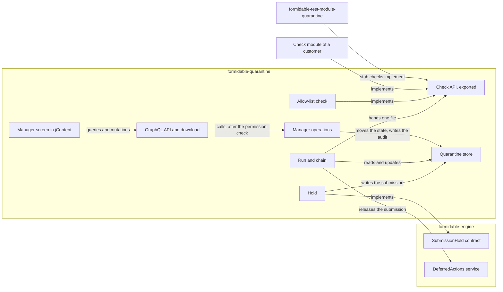
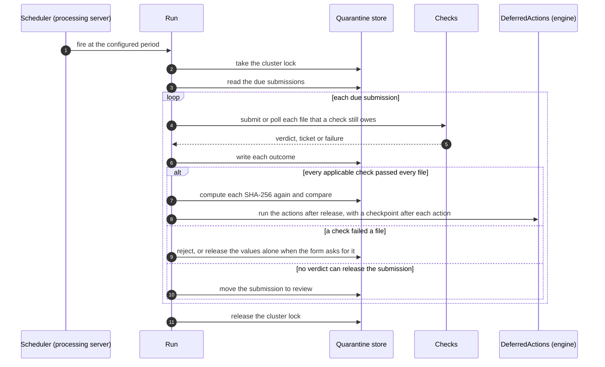
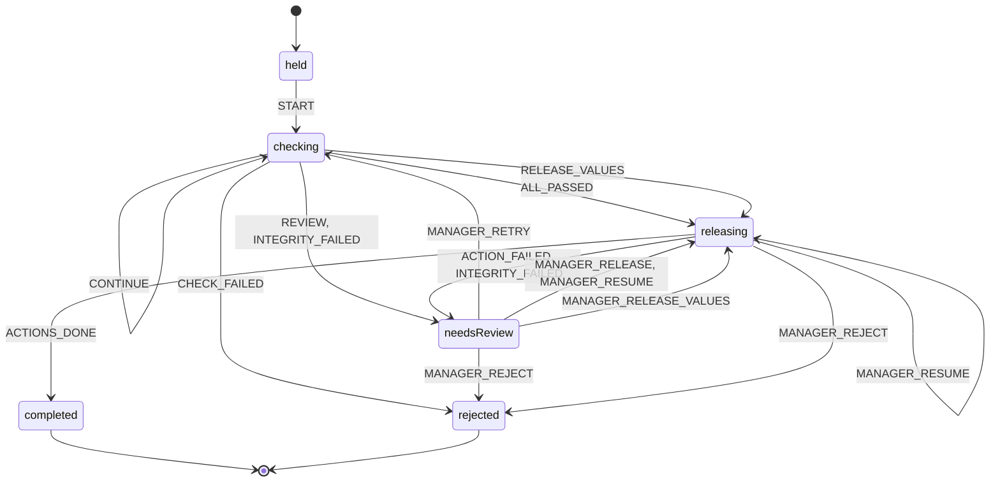
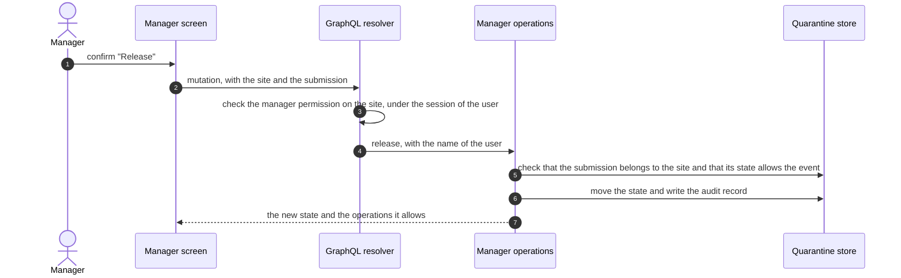

# Quarantine of the uploads: the module `formidable-quarantine`

This document is the design of the optional module `formidable-quarantine`. The module holds the uploads of a form,
runs checks on them after the request, and releases or rejects each submission. The engine side of the hold is in
[Form submission flow](form-submission-flow.md#the-hold-of-the-uploads), which this document does not repeat.

The design rests on two decisions:

- [ADR 0002](../adr/0002-a-switch-on-the-form-holds-its-uploads-until-release.md): a switch on the form holds its
  uploads, and an extension module provides the hold.
- [ADR 0003](../adr/0003-jahia-ships-the-quarantine-hold-as-an-optional-module.md): Jahia ships that hold as an
  optional module, and a customer writes only a check.

The module `formidable-quarantine` holds the hold, the quarantine tree, the run of the checks, the release and the
operations of a manager. Its code came from the test module `formidable-test-module-quarantine`, which keeps no hold
and writes no quarantine tree. The endpoints of the test suite are split in two:

- The inspection, the operations and the retention endpoints are in the module, under the paths they had in the
  test module.
- The test module keeps its stub checks, the control of the stubs, and a run-now endpoint. The exported package of
  the module offers a runner next to the check API. The run-now endpoint starts a run through the runner, and writes
  nothing under the tree itself.

## Building blocks

| Name | Responsibility |
|---|---|
| Check API | The exported, versioned package that a check module compiles against. It is the one extension point of the module. |
| Hold | The `SubmissionHold` service of the module. It decides whether it owns a form, stores the submission and returns. |
| Quarantine store | The quarantine tree in the repository: the held submissions, their values, their files, the outcomes and the audit. |
| Run and chain | The scheduled run. It finds the due submissions, asks the checks, and concludes: release, review or reject. |
| Manager operations | Retry, release, resume and reject, each allowed by the state machine and written to the audit. |
| GraphQL API and download | The API of the manager screen. A resolver checks the permission of the user on the site before every read and every operation. |
| Manager screen | A jContent route of the site: the list, the detail of a submission, the operations and the download. |
| Allow-list check | The check that the module ships. It reads only the metadata of a file, and applies to every file. It answers `FAIL` for a type outside its list, and `PASS` for a type on it. |

## The check API

A check is a service that qualifies one file, and a node type that a form lists in its "Quarantine checks" zone.
A check module provides both, and nothing else:

- The node type declares `fmdbmix:qualifier`, so the Page Builder offers it in the checks zone.
- The service registers under the check API and names the node type it serves.
- A check receives the metadata of the file, a stream of its bytes and its settings. It never receives a node of
  the repository.
- A check gives one of three answers:
  - a verdict, `PASS`, `FAIL` or `INCONCLUSIVE`;
  - a ticket that the run polls later;
  - a failure, retryable or not, when the check could not answer. Its setting `onUnavailable` then decides.
- A check declares its scope:
  - A `METADATA` check reads the name, the declared MIME type and the size of the file, and never a byte.
  - A `REMOTE` check sends the bytes out of the JVM.
  - An `IN_PROCESS` check reads the bytes inside the JVM.
- The chain refuses a list where an `IN_PROCESS` check reads a file before a `REMOTE` check passed it. A `METADATA`
  check can stand at any place in the list.

The allow-list check has the scope `METADATA`. Its `PASS` means only that the type of the file is allowed. With the
allow-list check alone in the list, every file of an allowed type is released with no scan. A scanner therefore
comes after the allow-list check.

The settings of a check come from its node. The run reads the node and gives the check its common settings
(`onInconclusive`, `onUnavailable`) and its own properties as a map of strings.

The check API follows semantic versioning. Jahia implements the types marked `@ProviderType`, and a check module
implements the types marked `@ConsumerType`. ADR 0003 decides that the build compares the exported package with its
last release. The module has no release, so no pom configures that comparison.

## Ownership of a form

The hold of this module ranks 100 ([The hold service](form-submission-flow.md#the-hold-service)). It reads only the
repository to decide whether it owns a form. The check services that are registered at that moment play no part:

| The form | The hold of the module |
|---|---|
| The site of the form has the module. | It owns the form and stores the submission, whatever the "Quarantine checks" list holds. |
| The site of the form does not have the module, and another hold ranks below it. | It hands the submission to the next hold below its ranking. |
| The site of the form does not have the module, and no other hold ranks below it. | It refuses the submission with FMDB-018. |
| The hold cannot read the form or its site. | It refuses the submission. |

- An empty list sends the submission to review at the run. So does a check type that no check service serves at
  the time of the run, because the run never skips a check type.
- A check module that redeploys changes the owner of no form. Its submissions stay held, and a manager retries them
  once the check service is back.
- A site that lists this module, or a known module that depends on it, has the module, whatever its other modules.
  A module of the site that the platform does not know, such as a check module that is not deployed, makes the hold
  refuse the submission only when no known module of the site brings this module. The hold never hands that
  submission to another hold, because the unknown module could depend on this module.
- A hold that wants some forms ranks above 100, such as a broker outside Jahia. It claims a form by the check
  types of its list, and hands any other form to the next hold.
- A hold hands a form only to a hold of a lower ranking. A hold of the same ranking never receives a handed-off
  form, because two holds of one ranking would hand a form to each other. The hold of this module and the sample hold
  compare with the ranking they are bound with, so a ranking that a configuration sets counts.
- The sample hold of `formidable-test-module-samples-java` ranks 200. It claims only the forms whose list holds
  `fmdbsample:sampleCheck`, and hands every other form down to the hold of this module.

## Runtime

### Intake

The hold stores the public values, the sensitive values, each file and the SHA-256 of each file, then returns.

### The scheduled run

- The scheduler calls the run at the period of the configuration of the run, `periodSeconds`, 60 seconds by
  default. A period of 0 turns the scheduled run off, and only "run now" runs the checks then. A change of the
  period applies at once.
- Each call makes one pass over each site that has a quarantine tree. The scheduler never starts a call while the
  call before runs.
- A submission is due when its state is `held`, or `checking` with its next attempt reached.
- A pass that brings no new verdict waits for the back-off. The delay after the first attempt is
  `backoffInitialSeconds`, 60 seconds by default. The delay grows by `backoffFactor`, 2 by default, at each
  attempt, up to `backoffCapSeconds`, one hour by default. When the attempts reach `maxAttempts`, 10 by default, the
  submission goes to review with the reason `ATTEMPTS_EXHAUSTED`.
- A file that no check of the list applies to goes to review with the reason `FILE_WITHHELD`.
- After a run, the module sends one review digest per site whose submissions entered `needsReview` in that run.
  The digest goes to the addresses of the site settings. It carries the count per form and a link to the manager
  screen, and never a value or a file name of a submission.
- After `completed` or `rejected`, the store deletes the values and the bytes. The record of the submission and its
  audit stay until the retention deletes them ([The scheduled purge](#the-scheduled-purge)).

### The lock of the run

Locks narrow the window in which two runs, or a run and an operation, work on one submission. The guard is the
compare-and-set of every state move:

- **Compare-and-set.** A move of the state reads the stored state in the session it saves with, and writes the new
  state only when the stored state is still the state the mover read. A concurrent save of the same held submission
  is refused by the repository. So a submission enters `releasing` from `checking` or `needsReview` once, and its
  actions after release run once. A run skips a submission that another run or an operation moved first, and
  reports it with the error `moved by another run or operation`. An operation answers a conflict.
- **The lock of the site in one server.** A pass of the run holds the lock of its site in the JVM for the whole
  pass, and so does an operation of a manager. An operation waits 2 seconds at most, then answers a conflict, "a
  run is in progress, retry". A pass of another site does not hold it back.
- **The lock of the run in the repository.** A pass takes the lock of the run of the site before it reads the held
  submissions of the site. The lock keeps one pass at a time on a site across the cluster:
  - The lock is the node `runLock` under the root of the quarantine tree of the site. It stores the owner of the
    lock and the end of its lease.
  - The owner is the identifier of the server (`cluster.node.serverId`), a token that each start of the lock
    service draws, and a token of the holder. Each pass is an owner of its own, even in one server.
  - An owner takes the lock when no owner holds it, or when its lease ended. Two owners that take the lock at the
    same moment both write the node: the repository saves the first write and refuses the second, so the second
    owner does not get the lock.
  - The lease lasts `lockLeaseSeconds`, 10 minutes by default. Before each submission, and before each call of a
    check and of the actions after release, a pass checks that its lease is still valid, and extends it once half
    of the lease has gone by. A pass that lost its lease, or cannot extend it, stops before the call, and keeps the
    report of what it already did.
  - The pass releases the lock when it ends, even after a failure. When the module stops, the lock service
    releases each lease it granted, and grants no lease any more: a pass of the old start that is still under way
    stops before its next submission or call. A server that stops with no release keeps the lock until the lease
    ends.
  - A scheduled run takes the lock of a site only when the site holds a due submission, which a query finds with
    no write. A scheduled run that does not get the lock skips the site until its next call. "Run now" answers
    "a run is in progress" instead.
- **The operations in a cluster.** An operation on another server does not take the lock of the site of this
  server. A release and a resume, which run the actions after release, take the lock of the run of the site in the
  repository for their duration, and a reject of a submission in `releasing` needs that no pass holds it. So a
  resume of a release that stopped never runs beside a release under way, on any server. Any other operation
  relies on the compare-and-set.

### The scheduled purge

The retention deletes each submission in a final state, `completed` or `rejected`, whose last change is older than
the limit, with its record, its audit and every other child. A submission in any other state (`held`, `checking`,
`releasing`, `needsReview`) is never deleted, whatever its age: it still waits for the run or for a manager. So the
tree does not grow without bound.

- The scheduler calls the retention on the processing server at the period of the configuration of the retention,
  `periodSeconds`, once a day by default. A period of 0 turns the scheduled purge off. The first call comes after
  one period, and never later than one hour after the module starts.
- Each call purges each site that has a quarantine tree, with the limit of the site.
- The limit of the platform is `retentionDays`, 30 days by default. A site can lower it with `retentionDays` of its
  site settings, the mixin `fmdbqmix:quarantineSite`. A value of a site above the limit of the platform is
  ignored, and so is a negative value. A site whose settings cannot be read keeps the limit of the platform.

### The states of a held submission

The events `RELEASE_VALUES` and `MANAGER_RELEASE_VALUES` serve a form with `onFail=releaseValues`:

- `RELEASE_VALUES` follows a `FAIL` verdict, and `MANAGER_RELEASE_VALUES` follows a reject by a manager.
- Both events delete the bytes of every file before they lead to `releasing` with the values alone. A later
  event, such as a release by a manager after a failed action, then has no file to release.
- The submission ends in `completed`, and its decision record keeps the failed verdict or the reject of the
  manager. The audit never states that every check passed.

### An operation of a manager

A user without the permission gets the same answer as for a submission that does not exist.

## Security

- The quarantine tree is under `/sites/<site>/formidable-quarantine/`, in the live workspace. Its root breaks the
  inheritance of the ACL and has no entry, so no site role reads it.
- The bytes of a file are a binary property of the item. They are never `jcr:data` of a file node, so no file
  servlet serves them, and no text extraction or listener reads them.
- The store computes the SHA-256 again before a release and before a download:
  - A mismatch before a release moves the submission to review with the reason `INTEGRITY_FAILED`.
  - A mismatch before a download refuses the download and writes an audit record. The submission stays in
    `needsReview`.
- The module reads the tree with a system session, and only after the permission check on the site node.
- No value of a submission appears in a log line or in an error message.

### Permissions

| Permission | Grants |
|---|---|
| `formidableQuarantineManage` | The list, the detail, and the operations retry, release, resume and reject, on the forms where it is granted. |
| `formidableQuarantineFileAccess` | The download of a held file, when the file access allows it. |

In this phase, the module declares `formidableQuarantineManage` and checks it on the live form. The role
`formidable-quarantine-manager`, granted on a form, gives it. The per-site role and `formidableQuarantineFileAccess`
come in a later phase. The second permission is separate, because releasing a submission and opening its file are
two different rights.

### File access by a reviewer

The setting `fileAccess` decides what a reviewer gets of a held file:

| Value | The reviewer gets |
|---|---|
| `none` | The metadata of each file and the verdict of each check. No byte leaves the quarantine before the release. |
| `download` | A download button, for a user with `formidableQuarantineFileAccess`. |

- The default is `none`.
- The value of the platform is a ceiling. A site and a form can lower the value and cannot raise it.
- A download is possible only in the state `needsReview`.
- The response is `application/octet-stream` with `Content-Disposition: attachment`, `X-Content-Type-Options:
  nosniff` and `Cache-Control: no-store`. The browser never shows the file inline.
- Each download writes an audit record with the operation `download`, the user and the time.
- The detail view shows a warning: "No check cleared this file. Open it only on a protected workstation."

## Settings

| Level | Where | Settings |
|---|---|---|
| Platform | The OSGi configuration of the module | The period of the run, the back-off, the lease of the lock of the run, the retention and the period of the purge, and the ceiling of `fileAccess`. |
| Site | A property of the site | A lower `fileAccess`, a lower retention of the site (`fmdbqmix:quarantineSite`), and the addresses of the review digest. |
| Form | The mixin `fmdbqmix:quarantinePolicy`, offered on a form with the switch on | `onFail`, the name of the scan status and its two values, `showValues`, and a lower `fileAccess`. |

- `onFail=reject` rejects the submission ([The scheduled run](#the-scheduled-run) states what the store keeps).
- `onFail=releaseValues` runs the actions after release with the values alone, with no file, and adds the scan
  status to the values. [The states of a held submission](#the-states-of-a-held-submission) give the two events of this
  path.
- The scan status is a value that the run adds to the values of the actions after release, and not a field of the
  form. The engine skips a posted value whose name is not a field of the form
  ([Field whitelist](form-submission-flow.md#field-whitelist-step-8--step-9)). Each time the form is published, the module
  checks that no field of the form has the name of the scan status. It refuses the publication otherwise. At
  release, the run writes the scan status over any value of that name. So the visitor cannot set the scan status.
- `showValues` shows the public values of a held submission in the detail view. The sensitive values never appear.

## Deployment

- The scheduled run and the scheduled purge start on the processing server only, on the RAM scheduler of Jahia. The
  module schedules them again each time it starts, and removes them when it stops.
- A lock in the repository keeps one run at a time on a site across the cluster
  ([The lock of the run](#the-lock-of-the-run)). "Run now" can start on any server, and takes the same lock.
- The module owns the root of the quarantine tree, `/sites/<site>/formidable-quarantine/`, of the type
  `fmdbq:quarantineRoot`. No other module writes under it.
- The module installs on the platform, and a site turns it on. The manager screen appears only on a site that has
  the module.
- The node types of the module use the prefixes `fmdbq` and `fmdbqmix`. The test module keeps `fmdbquar` for its
  stub checks ([CND module ownership](cnd-module-ownership.md)).
