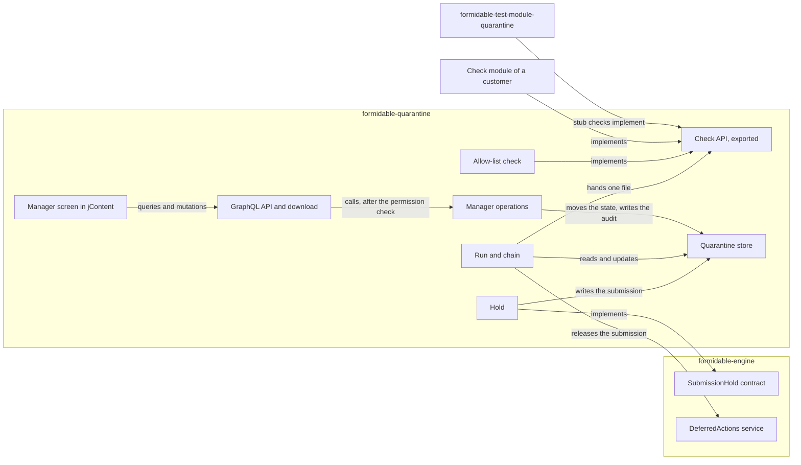
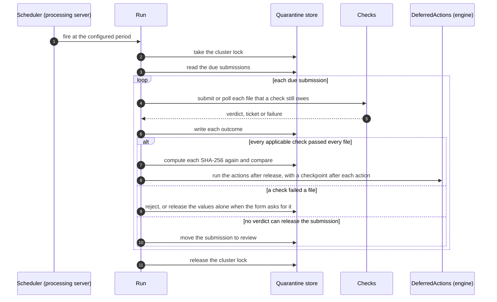
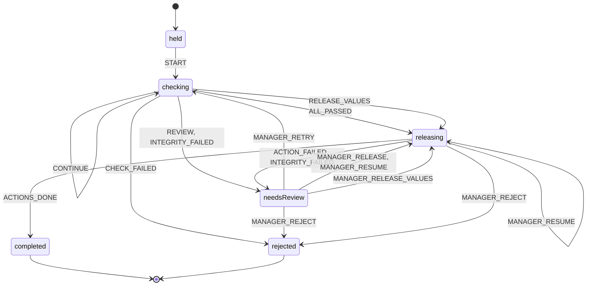
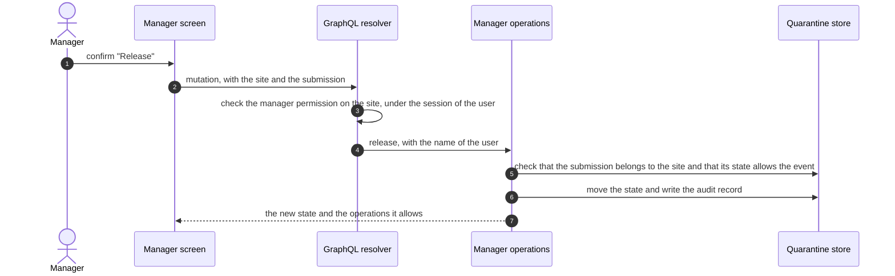

# Quarantine of the uploads: the module `formidable-quarantine`

This document is the design of the optional module `formidable-quarantine`. The module holds the uploads of a form,
runs checks on them after the request, and releases or rejects each submission. The engine side of the hold is in
[Form submission flow](form-submission-flow.md#the-hold-of-the-uploads), which this document does not repeat.

The design rests on two decisions:

- [ADR 0002](../adr/0002-a-switch-on-the-form-holds-its-uploads-until-release.md): a switch on the form holds its
  uploads, and an extension module provides the hold.
- [ADR 0003](../adr/0003-jahia-ships-the-quarantine-hold-as-an-optional-module.md): Jahia ships that hold as an
  optional module, and a customer writes only a check.

The module `formidable-quarantine` holds the hold, the quarantine tree, the run of the checks, the release and the
operations of a manager. Its code came from the test module `formidable-test-module-quarantine`, which keeps no hold
and writes no quarantine tree. The test suite reaches the module in two ways:

- It reads the quarantine, runs the operations and the retention through the GraphQL API of the module
  ([The GraphQL API](#the-graphql-api)), as the manager screen does.
- The test module keeps its stub checks, the control of the stubs, and a run-now endpoint. The exported package of
  the module offers a runner next to the check API. The run-now endpoint starts a run through the runner, and writes
  nothing under the tree itself.

## Building blocks

| Name | Responsibility |
|---|---|
| Check API | The exported, versioned package that a check module compiles against. It is the one extension point of the module. |
| Hold | The `SubmissionHold` service of the module. It decides whether it owns a form, stores the submission and returns. |
| Quarantine store | The quarantine tree in the repository: the held submissions, their values, their files, the outcomes and the audit. |
| Run and chain | The scheduled run. It finds the due submissions, asks the checks, and concludes: release, review or reject. |
| Manager operations | Retry, release, resume and reject, each allowed by the state machine and written to the audit. |
| GraphQL API and download | The API of the manager screen. A resolver checks the permission of the user on the site before every read and every operation. |
| Manager screen | A jContent route of the site: the list, the detail of a submission, the operations and the download. |
| Allow-list check | The check that the module ships. It reads only the metadata of a file, and applies to every file. It answers `FAIL` for a type outside its list, and `PASS` for a type on it. |

## The check API

A check is a service that qualifies one file, and a node type that a form lists in its "Quarantine checks" zone.
A check module provides both, and nothing else:

- The node type declares `fmdbmix:qualifier`, so the Page Builder offers it in the checks zone.
- The service registers under the check API and names the node type it serves.
- A check receives the metadata of the file, a stream of its bytes and its settings. It never receives a node of
  the repository.
- A check gives one of three answers:
  - a verdict, `PASS`, `FAIL` or `INCONCLUSIVE`;
  - a ticket that the run polls later;
  - a failure, retryable or not, when the check could not answer. Its setting `onUnavailable` then decides.
- A check declares its scope:
  - A `METADATA` check reads the name, the declared MIME type and the size of the file, and never a byte.
  - A `REMOTE` check sends the bytes out of the JVM.
  - An `IN_PROCESS` check reads the bytes inside the JVM.
- The chain refuses a list where an `IN_PROCESS` check reads a file before a `REMOTE` check passed it. A `METADATA`
  check can stand at any place in the list.

The allow-list check has the scope `METADATA`. Its `PASS` means only that the type of the file is allowed. With the
allow-list check alone in the list, every file of an allowed type is released with no scan. A scanner therefore
comes after the allow-list check.

The settings of a check come from its node. The run reads the node and gives the check its common settings
(`onInconclusive`, `onUnavailable`) and its own properties as a map of strings.

The check API follows semantic versioning. Jahia implements the types marked `@ProviderType`, and a check module
implements the types marked `@ConsumerType`. ADR 0003 decides that the build compares the exported package with its
last release. The module has no release, so no pom configures that comparison.

## Ownership of a form

The hold of this module ranks 100 ([The hold service](form-submission-flow.md#the-hold-service)). It reads only the
repository to decide whether it owns a form. The check services that are registered at that moment play no part:

| The form | The hold of the module |
|---|---|
| The site of the form has the module. | It owns the form and stores the submission, whatever the "Quarantine checks" list holds. |
| The site of the form does not have the module, and another hold ranks below it. | It hands the submission to the next hold below its ranking. |
| The site of the form does not have the module, and no other hold ranks below it. | It refuses the submission with FMDB-018. |
| The hold cannot read the form or its site. | It refuses the submission. |

- An empty list sends the submission to review at the run. So does a check type that no check service serves at
  the time of the run, because the run never skips a check type.
- A check module that redeploys changes the owner of no form. Its submissions stay held, and a manager retries them
  once the check service is back.
- A site that lists this module, or a known module that depends on it, has the module, whatever its other modules.
  A module of the site that the platform does not know, such as a check module that is not deployed, makes the hold
  refuse the submission only when no known module of the site brings this module. The hold never hands that
  submission to another hold, because the unknown module could depend on this module.
- A hold that wants some forms ranks above 100, such as a broker outside Jahia. It claims a form by the check
  types of its list, and hands any other form to the next hold.
- A hold hands a form only to a hold of a lower ranking. A hold of the same ranking never receives a handed-off
  form, because two holds of one ranking would hand a form to each other. The hold of this module and the sample hold
  compare with the ranking they are bound with, so a ranking that a configuration sets counts.
- The sample hold of `formidable-test-module-samples-java` ranks 200. It claims only the forms whose list holds
  `fmdbsample:sampleCheck`, and hands every other form down to the hold of this module.

## Runtime

### Intake

The hold stores the public values, the sensitive values, each file and the SHA-256 of each file, then returns.

### The scheduled run

- A submission is due when its state is `held`, or `checking` with its next attempt reached.
- A pass that brings no new verdict waits for the back-off. When the attempts are exhausted, the submission goes to
  review with the reason `ATTEMPTS_EXHAUSTED`.
- A file that no check of the list applies to goes to review with the reason `FILE_WITHHELD`.
- After a run, the module sends one review digest per site whose submissions entered `needsReview` in that run.
  The digest goes to the addresses of the site settings. It carries the count per form and a link to the manager
  screen, and never a value or a file name of a submission.
- After `completed` or `rejected`, the store deletes the values and the bytes. The record of the submission and its
  audit stay until the retention deletes them.

### The states of a held submission

The events `RELEASE_VALUES` and `MANAGER_RELEASE_VALUES` serve a form with `onFail=releaseValues`:

- `RELEASE_VALUES` follows a `FAIL` verdict, and `MANAGER_RELEASE_VALUES` follows a reject by a manager.
- Both events delete the bytes of every file before they lead to `releasing` with the values alone. A later
  event, such as a release by a manager after a failed action, then has no file to release.
- The submission ends in `completed`, and its decision record keeps the failed verdict or the reject of the
  manager. The audit never states that every check passed.

### An operation of a manager

A user without the permission gets the same answer as for a submission that does not exist.

### The GraphQL API

The module extends the GraphQL schema of the platform (`/modules/graphql`) with one query and one mutation, both
named `formidableQuarantine(siteKey)`:

| Field | Answers |
|---|---|
| `counts` | The number of held submissions of the site in each state. |
| `forms` | The forms of the site that have held submissions, each with its identifier, its title and its number of held submissions, ordered by title. |
| `submissions(formId, states, offset, limit)` | A page of the held submissions of the site, or of one form, oldest first. `limit` is 25 by default and 100 at most: a larger value reads as 100. `states` names each state once at most. |
| `submission(id)` | One held submission, or `null` when the site has none with this identifier. |
| `operate(id, operation)` | The mutation of a manager: `RETRY`, `RELEASE`, `RESUME` or `REJECT`. It answers the submission as the operation left it. |
| `purge(olderThanDays)` | The mutation of the retention, for server administrators only. |

- The identifier of a held submission is its path below the quarantine root of its site:
  `<formId>/YYYY/MM/DD/held-<uuid>`. The API reads it below the root of the site of the request only, so an
  identifier of another site names nothing.
- A held submission answers its state, the names of its fields, its files with the outcome of each check, its
  decision, its audit and `allowedOperations`. `allowedOperations` applies the rules of the operations: the state
  machine, then the decision for a release or a resume in `needsReview`.
- `publicValues` is `null` unless the form sets `showValues`. The sensitive values never appear, only the names of
  their fields.
- A page and the counts come from queries of the repository on the held submissions below the quarantine root of
  the site. The form and the states enter each query as bound values. The page reads at most 100 records. The
  `totalCount` of a page and each of the `counts` run one count query over every held record of the site that
  matches: their cost follows the number of records that the site keeps, which the retention purge bounds in
  practice. A request runs each count query once, however many aliases ask for it, and an operation or a purge
  counts again. A page leaves out a record that names another site, as the reading by identifier does; only a
  damaged tree holds one, and the counts still count it.
- `forms` runs one query of the folders of the forms below the quarantine root, then one count query per form, read
  once per request as the counts are. It binds no value: the root is its one literal. A form whose submissions the
  retention purged is left out.
- The records of the submissions of a request, their outcomes, decision, audit and values, are read in one session,
  on the first field that needs them. An operation reads the records and the form of its submission before it
  answers, so that a failure of that read says that the operation ran.
- The query depth and complexity limits of the GraphQL provider of the platform bound the number of aliased
  selections of a request. Aliases of `formidableQuarantine` on one site share one reading of the site: its counts,
  totals, forms and records are read once per request. The API adds no limit of its own beyond the page of 100.
- Any failure answers an error with a fixed message. The log line names the site, the path or the class of the
  failure, never a value. An operation that ran, and whose submission cannot be read again, answers that it ran.
- A request that did not run answers an error whose `extensions.code` says why. A client reads the code, never the
  message. An error with no code is a failure, and the operation may or may not have run:

| Code | The request did not run because |
|---|---|
| `CONFLICT` | The state of the submission, or its decision, does not allow the operation any more. |
| `NOT_FOUND` | The site has no held submission with this identifier, or the user does not manage the site. |
| `FORBIDDEN` | The request needs a right that a manager does not have: the purge is for server administrators. |

- The API has no field for the file access yet (`fileAccess`, `canAccessFiles`): the download comes with the file
  access.

## Security

- The quarantine tree is under `/sites/<site>/formidable-quarantine/`, in the live workspace. Its root breaks the
  inheritance of the ACL and has no entry, so no site role reads it.
- The bytes of a file are a binary property of the item. They are never `jcr:data` of a file node, so no file
  servlet serves them, and no text extraction or listener reads them.
- The store computes the SHA-256 again before a release and before a download:
  - A mismatch before a release moves the submission to review with the reason `INTEGRITY_FAILED`.
  - A mismatch before a download refuses the download and writes an audit record. The submission stays in
    `needsReview`.
- The module reads the tree with a system session, and only after the permission check on the site node.
- The mutations of the API have no request check of their own, and no token of `jahia-csrf-guard` protects
  `/modules/graphql`. Three controls of the platform stand against a forged request:
  - The scope `formidable-quarantine` of the API security filter applies only to a request whose `Origin` or
    `Referer` is this server. A request from another site, or with neither header, gets no access to the fields.
  - The mutation is sent as a JSON POST: a page of another site cannot send that media type without a CORS
    preflight.
  - The fetch-metadata policy of `jahia-csrf-guard` refuses a write whose `Sec-Fetch-Site` is `cross-site`.
- Spec 90 sends the mutation `operate` in the shapes that a cross-site page can forge, checks each refusal and that
  nothing changes, and sends the same mutation from a page of this server as the control.
- No value of a submission appears in a log line or in an error message.

### Permissions

| Permission | Grants |
|---|---|
| `formidableQuarantineManage` | The list, the detail, and the operations retry, release, resume and reject, on the forms of the site where it is granted. |
| `formidableQuarantineFileAccess` | The download of a held file, when the file access allows it. |

- The site role `formidable-quarantine-manager` gives `formidableQuarantineManage`. The module creates the role when
  it starts. The role gives no privileged access, so its holder reads no draft of the site.
- Each field `formidableQuarantine(siteKey)` checks the permission on the site node of the live workspace, under the
  session of the user, before it reads anything. A grant of the role applies once the site is published, and a site
  with no live node has no manager. A revocation applies the same way: a role removed in the edit workspace stops
  granting the list and the operations only once the site is published, because the check reads the live ACL.
- A failure of the repository during the check answers an error, never the answer of a user who does not manage the
  site.
- The API security filter of the platform admits only privileged users to `/modules/graphql`, and the role gives no
  privileged access. The module therefore ships the scope `formidable-quarantine`, which opens the two fields
  `formidableQuarantine` and the types of the module that they reach, from a page of this server, and nothing else of
  the platform. The scope is the door, and the check of the module on the site is the lock. The filter can require a
  permission on one fixed path only, so the scope cannot require the permission on the site of the request: any user
  of a page of this server passes the door, and the module answers `null` to a user who does not manage the site. A user without the permission gets `null`, which is also the answer for a site
  that does not exist. A server administrator is a manager of every site that exists.
- The operations check the permission again on the site of the held submission, and check that the submission lies
  under the quarantine root of that site.
- The retention through the API is for server administrators only, because the retention is a setting of the
  platform.
- The module does not declare `formidableQuarantineFileAccess` yet: it comes with the download. It is separate,
  because releasing a submission and opening its file are two different rights.

### File access by a reviewer

The setting `fileAccess` decides what a reviewer gets of a held file:

| Value | The reviewer gets |
|---|---|
| `none` | The metadata of each file and the verdict of each check. No byte leaves the quarantine before the release. |
| `download` | A download button, for a user with `formidableQuarantineFileAccess`. |

- The default is `none`.
- The value of the platform is a ceiling. A site and a form can lower the value and cannot raise it.
- A download is possible only in the state `needsReview`.
- The response is `application/octet-stream` with `Content-Disposition: attachment`, `X-Content-Type-Options:
  nosniff` and `Cache-Control: no-store`. The browser never shows the file inline.
- Each download writes an audit record with the operation `download`, the user and the time.
- The detail view shows a warning: "No check cleared this file. Open it only on a protected workstation."

## Settings

| Level | Where | Settings |
|---|---|---|
| Platform | The OSGi configuration of the module | The period of the run, the back-off, the retention, and the ceiling of `fileAccess`. |
| Site | A property of the site | A lower `fileAccess`, the retention of the site, and the addresses of the review digest. |
| Form | The mixin `fmdbqmix:quarantinePolicy`, offered on a form with the switch on | `onFail`, the name of the scan status and its two values, `showValues`, and a lower `fileAccess`. |

- `onFail=reject` rejects the submission ([The scheduled run](#the-scheduled-run) states what the store keeps).
- `onFail=releaseValues` runs the actions after release with the values alone, with no file, and adds the scan
  status to the values. [The states of a held submission](#the-states-of-a-held-submission) give the two events of this
  path.
- The scan status is a value that the run adds to the values of the actions after release, and not a field of the
  form. The engine skips a posted value whose name is not a field of the form
  ([Field whitelist](form-submission-flow.md#field-whitelist-step-8--step-9)). Each time the form is published, the module
  checks that no field of the form has the name of the scan status. It refuses the publication otherwise. At
  release, the run writes the scan status over any value of that name. So the visitor cannot set the scan status.
- `showValues` shows the public values of a held submission in the detail view. The sensitive values never appear.

## Deployment

- The run starts on the processing server only.
- A lock in the repository keeps one run at a time across the cluster.
- The module owns the root of the quarantine tree, `/sites/<site>/formidable-quarantine/`, of the type
  `fmdbq:quarantineRoot`. No other module writes under it.
- The module installs on the platform, and a site turns it on. The manager screen appears only on a site that has
  the module.
- The node types of the module use the prefixes `fmdbq` and `fmdbqmix`. The test module keeps `fmdbquar` for its
  stub checks ([CND module ownership](cnd-module-ownership.md)).
